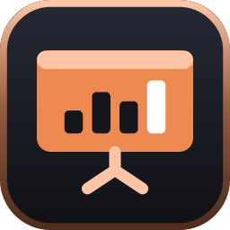

<p align="center">
  
</p>

<h1 align="center">Local Slides</h1>

<p align="center">
  A presentation editor and slide show for Windows and Linux. Works offline, needs no account, written in Rust.<br>
  <a href="https://github.com/Anon5T4R/local-slides/releases/latest">Download</a> ·
  <a href="ROADMAP.md">Roadmap and status</a> ·
  <a href="#where-it-comes-from">Where it comes from</a> ·
  <a href="#how-it-is-made">How it is made</a>
</p>

<!-- screenshot: the editor with a deck open, thumbnails and the ribbon visible; dark and light -->

## What it does

- **Build the deck:** slide masters and the eleven standard layouts, with placeholders that inherit
  position and formatting from the layout; eight built-in themes with their colour and font
  schemes, and further colour, font and effect schemes; sections, custom shows, speaker notes,
  comments with replies and a resolve state, headers and footers, custom slide sizes.
- **Draw:** the Office preset shapes re-derived from ECMA-376, with adjust handles; connectors that
  stay attached to the shapes they join; freeform, curve and scribble; merge shapes (union,
  combine, fragment, intersect, subtract); solid, gradient, picture and pattern fills; outlines
  with dashes and arrowheads; shadows, glow and soft edges; picture styles, artistic effects,
  background removal and compression.
- **Write:** in-place editing with character and paragraph formatting, bullets and numbering,
  columns, autofit, vertical text, fields and hyperlinks.
- **Add content:** pictures, tables, charts, SmartArt built from an outline, audio and video (the
  decoders are Rust, ported from FilmCraft).
- **Present:** transitions including Morph; entrance, emphasis, exit and motion-path animations,
  with builds by paragraph, word or letter; full-screen show; presenter view; a pen; rehearsed
  timings; media playback.
- **Keep the work:** AutoRecover brings unsaved presentations back on the next start, and a crash
  guard reports a panic instead of the window disappearing.
- **Automate:** every action is a command with a stable id, dispatched by the app, by
  `localslides-cli`, by a JSON control channel and by an MCP server for AI agents
  ([docs/mcp.md](docs/mcp.md)).
- **Interface:** English, Portuguese (Brazil) and Spanish; automatic, light or dark theme.

What works well, what is weak and what is planned — PPTX fidelity against decks from elsewhere,
SVG pictures, editing chart data, printing, the depth of the animation and Format Shape panels — is
in the [roadmap](ROADMAP.md).

## Formats

| Format | Read | Write |
|---|---|---|
| `.pptx` | yes | yes |
| `.potx` / `.ppsx` | yes | yes, as a template / slide show |
| `.deckcraft` (native; also reads `.slidecraft`) | yes | yes |
| `.thmx` (Office theme) | colours, fonts and effects | no |
| Outline `.txt` / `.md` / `.rtf` | yes (titles become slides, items become bullets) | `.txt` / `.rtf` |
| PDF | — | slides, notes pages and handouts, with an invisible real-text layer |
| PNG / JPEG | — | one file per slide |
| Animated GIF | — | the deck (transitions and animations do not enter) |
| `.pptm` / `.potm` / `.ppsm`, `.ppt`, `.odp` | no | no |

The native `.deckcraft` file is a zip with a `mimetype` entry, `presentation.json`, the media and
the chart parts, kept byte for byte from the upstream, including its MIME string
`application/vnd.storyteller.deckcraft+zip`. On PPTX, whatever the app does not model is kept as it
came and written back on save, so opening and saving a deck does not throw those parts away.

## Where it comes from

Local Slides is a fork of [DeckCraft](https://github.com/storytold/deckcraft) by
[ArtCraft](https://getartcraft.com), licensed MIT or Apache-2.0. The base is `v0.15.1` (upstream
commit `9bac60ff`), copied without history. The editor, the renderer, the PPTX reader and writer,
the shape geometry, the sample deck and the media decoders are their work.

**Why a fork.** We wanted a set of desktop apps that look and behave the same, update and sign the
same way, and follow our own priorities: Windows and Linux first, files that stay local, AI only
with your own key, and agents able to drive every app. A fork lets us decide that without asking
the upstream to change direction.

We also wanted "written in Rust" to hold for everything the app runs. The updater and every other
network path use rustls with a RustCrypto provider, so `ring` (partly C and assembly), `aws-lc` and
OpenSSL are not in the program you install.

**What changed here:**

- Name, icon, app identifiers and packaging; own CI, and a release built from a tag instead of the
  upstream's `release` branch.
- The window layer: one native window per presentation, and View ▸ New Window for a second one on
  the same deck (the upstream switches presentations inside a single window).
- Our own updater (`craft-update`) and its app card.
- `libs/` (the egui, winit and craft-libs forks, vendored at a pinned commit) and the fonts, so a
  release builds from this repository and crates.io only.
- Live automation of the open app goes through `craft-mcp`, shared by every Local app.
- No browser build: the interfaces are the desktop app and `localslides-cli`.

**What we still take from upstream:** bug fixes that matter to us (crashes, data loss, security,
file compatibility), reviewed one by one and adapted. New features and UI changes are not merged
automatically. Each sync is recorded in [docs/UPSTREAM-SYNC.md](docs/UPSTREAM-SYNC.md).

## Download

Windows x64: an `.msi` for all users (into `Program Files\Local Slides`, needs administrator
rights), a `-user` `.msi` for the current account only (into `%LOCALAPPDATA%\Programs`, no UAC
prompt — pick one of the two), or a portable `.zip`. The installer makes Local Slides the default
app for `.deckcraft` and an "Open with" choice for `.pptx`, `.potx` and `.ppsx`; it never takes
those file types over from PowerPoint.

Linux x86_64: `.AppImage`, `.deb`, `.rpm`, Arch `.pkg.tar.zst` or `.tar.gz`, plus a
`localslides-cli` tarball for a machine without a desktop. All in
[Releases](https://github.com/Anon5T4R/local-slides/releases). macOS and FreeBSD are not published;
their packagers stay in `packaging/`. The packaging scripts also take a Windows `x86`/`arm64` build
and a Linux `aarch64` cross-build, but no such artifact is published yet.

Release files are signed with [minisign](https://jedisct1.github.io/minisign/) when the release runs
with the suite key — the same key for every Local app — and each release publishes a
`SHA256SUMS.txt`. To check a file:

```sh
minisign -Vm <file> -P RWTqN+hTTCFbDCGCA1cEJRLp2FSluxIUiJfqdoAYwkwNNVH5MTYH8qSN
```

The public key is also in [packaging/minisign.pub](packaging/minisign.pub). The in-app updater
checks the download against the release's SHA-256; it also verifies the minisign signature, but for
now a bad signature is only logged, not refused.

## Build from source

Rust 1.95 or newer.

```sh
git clone https://github.com/Anon5T4R/local-slides
cd local-slides
cargo run --release -p localslides                  # the app
cargo run --release -p localslides -- --sample      # the app with the sample deck
cargo xtask ci                                      # all local checks
```

On Linux the build also needs the ALSA headers for slide-show sound (`libasound2-dev` on Debian and
Ubuntu, `alsa-lib-devel` on Fedora, `alsa-lib` on Arch). Fonts are vendored in `assets/craft-fonts/`
and embedded by the build.

## How it is made

Local Slides follows the same rules as every Local app: local files and no account, Rust only
(including the UI and the cryptography), one self-contained repository per app, forks with selective
sync, governed dependencies, signed releases built from a tag, optional AI with your own provider,
and MCP so agents can use the app. Most of the code is written by AI coding agents (Claude Code and
OpenCode) from written plans, reviewed by the maintainer and held to the same checks and CI. The
reasons for each decision:
[How we make the Local apps](https://github.com/Styx-Studios/.github/blob/main/profile/README.md#how-we-make-the-local-apps).

## AI

The AI tab does nothing until you add a connection and your own key: any OpenAI-compatible service,
or a local server such as llama.cpp or Ollama. The key lives in the OS keychain. It offers three
deck actions — generate a presentation from a topic (up to 40 slides), rewrite one slide, correct
the text of one or several slides — and a chat panel that sends the deck's outline as context.
Answers are applied through the app's own commands inside one undo group, so a failed apply rolls
back, and the AI never writes the file itself.

The only other network use is the update check on GitHub when the app starts, and there is no
setting to turn it off yet. No account, analytics or crash reporting.

## License and credits

MIT or Apache-2.0, at your option ([LICENSE-MIT](LICENSE-MIT), [LICENSE-APACHE](LICENSE-APACHE));
third-party notices in [NOTICE](NOTICE). "DeckCraft" and "ArtCraft" are the names of the upstream
project and its team; this repository and its packages use only the Local Slides name. Every bundled
font, icon and image, with its author, source and licence, is in [ATTRIBUTION.md](ATTRIBUTION.md);
release builds embed the fonts of
[craft-fonts](https://github.com/storytold/craft-fonts/blob/main/ATTRIBUTION.md) (SIL Open Font
License 1.1). Other Local apps: [the full list](https://github.com/Styx-Studios).
