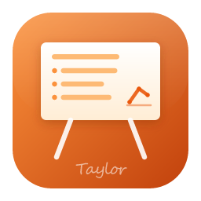
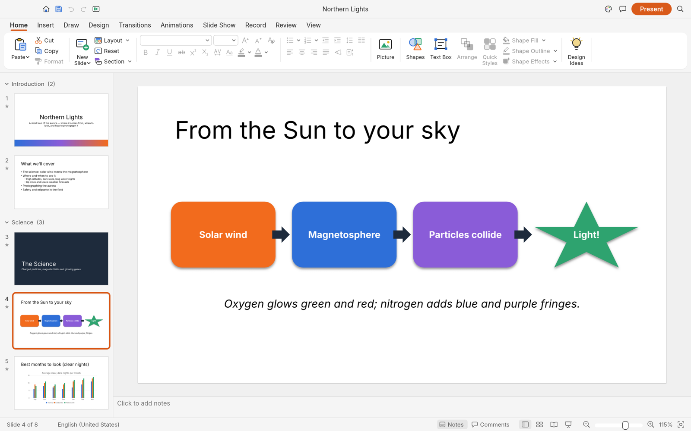
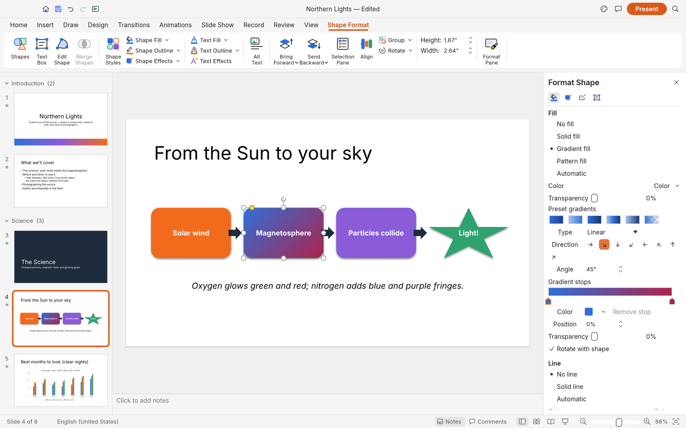
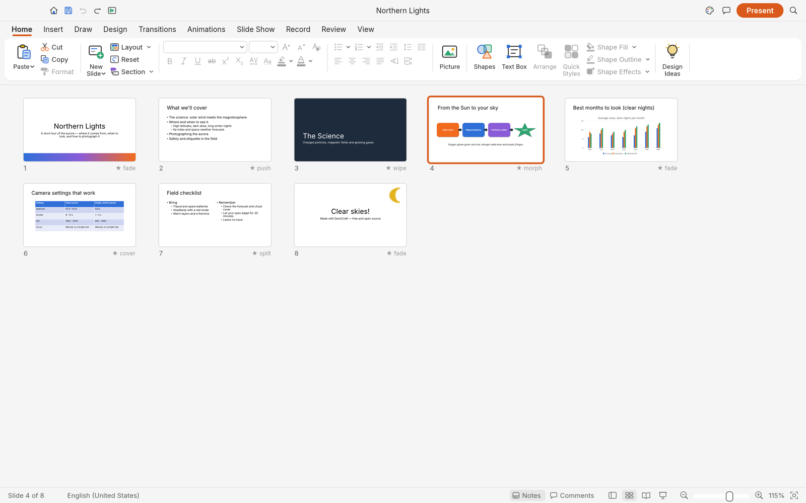
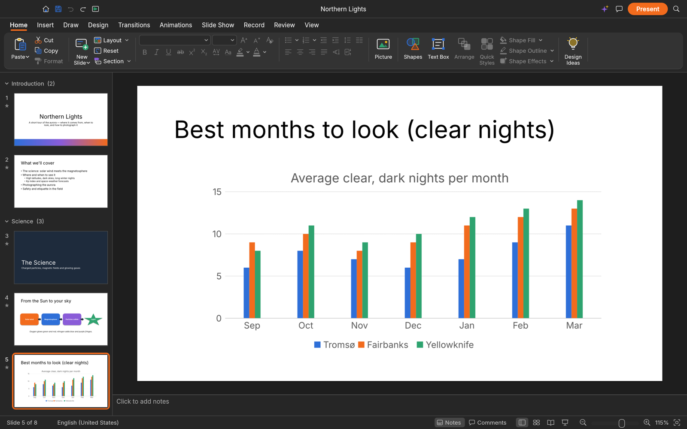
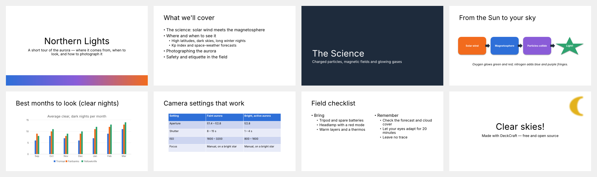

<p align="center">
  
</p>

<h1 align="center">Local Slides</h1>

<p align="center">
  <b>Presentations and slide shows; an open-source, modern presentation and slide designer, built in pure Rust.</b>
</p>

<p align="center">
  Build decks with themes, layouts, shapes, pictures, tables, charts, transitions and animations,
  open and save .pptx presentation files, and present them full screen. Native on macOS, Windows,
  Linux and FreeBSD, and in the browser. Every button is also a command that the CLI and AI agents
  (through MCP) can drive.
</p>

<p align="center">
  <a href="https://github.com/Anon5T4R/local-slides"><b>Local Slides on GitHub</b></a>
</p>

<br>

<p align="center">
  
</p>

<p align="center">
  <a href="#what-works-today">What works</a> ·
  <a href="#getting-started">Getting started</a> ·
  <a href="#agents-cli-and-mcp">Agents, CLI and MCP</a> ·
  <a href="#roadmap">Roadmap</a> ·
  <a href="#downloads">Downloads</a> ·
  <a href="#the-local-suite">The Local suite</a> ·
  <a href="#license-and-credits">License</a>
</p>

## What works today

Local Slides is in alpha, heading for beta (see the [roadmap](ROADMAP.md)).
Today it can:

- **Make decks**: slide masters and eleven layouts with placeholders that inherit position and
  formatting, eight original themes with colour and font schemes, sections, notes, comments,
  headers and footers, custom slide sizes.
- **Draw**: 150+ preset shapes with adjust handles, connectors that stay glued to shapes, freeform,
  curve and scribble tools, merge shapes (union, combine, fragment, intersect, subtract), gradient,
  picture and pattern fills, outlines with dashes and arrowheads, shadows, glow, soft edges and
  reflections.
- **Write**: in-place text editing with full font and paragraph formatting, bullets and numbering,
  columns, autofit, vertical text, fields and hyperlinks.
- **Add content**: pictures with crop and corrections, tables with styles, charts, SmartArt basics,
  audio and video (MP3, AAC, FLAC, ALAC, Ogg, Opus, WAV, AIFF; H.264, HEVC, VP9, AV1).
- **Present**: transitions (including Morph), entrance/emphasis/exit and motion-path animations,
  by-paragraph builds, full-screen slide show, presenter view, pen, rehearse timings, media playback.
- **Exchange files**: open and save .pptx presentations, export PDF (slides, notes pages, handouts
  with selectable text), PNG/JPEG, an animated GIF of the deck and outlines. Unsaved work is kept by AutoRecover.
- **Automate**: 200+ commands with undo, all scriptable from the CLI, a JSON control channel and an
  MCP server for AI agents.

<table>
  <tr>
    <td width="50%"><br><sub>Shape Format contextual tab and selection handles</sub></td>
    <td width="50%"><br><sub>Format Shape pane: gradient type, direction and stops</sub></td>
  </tr>
  <tr>
    <td width="50%"><br><sub>Slide Sorter with each slide's transition</sub></td>
    <td width="50%"><br><sub>Dark mode, with a native chart</sub></td>
  </tr>
</table>

<p align="center">
  <br>
  <sub>The built-in sample deck, rendered by <code>localslides-cli render --sample --all</code></sub>
</p>

The honest picture, area by area, is in [ROADMAP.md](ROADMAP.md),
[docs/target-app-parity.md](docs/target-app-parity.md),
[docs/gaps.md](docs/gaps.md) and the generated
[docs/parity-checklist.md](docs/parity-checklist.md).

## Getting started

```sh
git clone https://github.com/Anon5T4R/local-slides
cd local-slides
cargo build --locked
cargo run --release -p localslides -- --sample          # the desktop app with the sample deck
cargo run --release -p localslides -- deck.pptx         # open a presentation
```

On Linux, the build also needs the ALSA headers for slide-show sound: `alsa-lib-devel` on Fedora,
`libasound2-dev` on Debian and Ubuntu, `alsa-lib` on Arch. Without them it stops at `alsa-sys`.

Fonts come from [craft-fonts](https://github.com/storytold/craft-fonts): clone it next to this repo
(`../craft-fonts`) and local builds pick it up automatically; without it Local Slides uses your system
fonts.

PDF export uses the shared `craft-pdf` writer with import features disabled. See
[`crates/pdf/README.md`](crates/pdf/README.md) for the dependency and validation requirements.

### Logs

The desktop app writes its `log` records to standard error and to `logs/localslides.log` in the
settings directory, beside `ui.json` and `prefs.json` (Linux `~/.config/localslides/logs/`, or
`$XDG_CONFIG_HOME/localslides/logs/`; macOS `~/Library/Application Support/Local Slides/logs/`; Windows
`%APPDATA%\Local Slides\logs\`). A start from a desktop menu or the Dock has no terminal, so this file
is what to attach to a bug report: the crash guard's panic report, a failed crash-recovery save,
parts skipped on import and audio output problems land there. Each launch moves the
previous log to `localslides.1.log` (and that one to `localslides.2.log`), so the log of a run that
crashed survives the next start. The file stops growing at 16 MiB. `--version` writes no file.

| Variable | Effect |
|---|---|
| `RUST_LOG` | Log levels for standard error and the log file. Default: `info` for Local Slides' own crates, `warn` for everything else. env_logger-style directives replace that, e.g. `RUST_LOG=debug`, `RUST_LOG=warn,localslides_pptx=trace` or `RUST_LOG=info,wgpu_core=warn`; a directive ending in `*` covers every target starting with it (`localslides*=debug`). |

The logger is `apps/localslides/src/logging.rs`; the realtime audio callback does not log. The web
app logs to the browser console instead.

## Agents, CLI and MCP

Every action in Local Slides is a command with a stable id, so people, scripts and AI agents use the
same verbs:

```sh
localslides-cli commands format.          # list commands
localslides-cli run --sample --cmd 'slide.new={"layout":"titleOnly","title":"Hello"}' --save hello.deckcraft
localslides-cli mcp                       # MCP server over stdio (headless)
localslides-cli mcp --connect 7990        # drive the running app (localslides --control 7990)
localslides-cli mcp --automation-read-root DIR --automation-write-root DIR   # confine the headless agent to folders
```

See [docs/mcp.md](docs/mcp.md) and the [control protocol](docs/control-protocol.md).

## Architecture

| Layer | Crate | Job |
|---|---|---|
| L0 | `localslides-geom`, `localslides-color` | units, transforms, preset shapes; colour |
| L1 | `localslides-model` | presentation, masters, layouts, slides, shapes, text, themes |
| L2 | `localslides-fonts`, `localslides-text` | font database and shaping; text layout |
| L3 | `localslides-render` | rasteriser (vello_cpu) |
| L4 | `localslides-format`, `localslides-pptx` | native `.deckcraft` format; OOXML |
| L5 | `localslides-engine` | session, undo, 200+ commands, tools, keys, sample |
| L6 | `localslides-mcp` | MCP server |
| L7 | `localslides-ui-egui` | the editor front end (swappable) |
| apps | `localslides`, `localslides-cli`, `localslides-web` | desktop, command line, browser |

`cargo xtask ci` runs formatting, clippy, the tests, the asset-attribution check, the layering
check and the wasm build. Contributor and agent instructions: [AGENTS.md](AGENTS.md).

## Roadmap

Local Slides is in **alpha**. It covers **84% of the features tracked in
[`docs/target-app-parity.md`](docs/target-app-parity.md) by breadth** (92% of the core ones,
measured) and is about **55% ready for real work across all tracked capabilities** (estimated).
See [ROADMAP.md](ROADMAP.md) for the stage, numbers by dimension and what's next, and
[docs/gaps.md](docs/gaps.md) for every known shortfall.

## Downloads

**Download Local Slides** from GitHub: the [latest release](https://github.com/Anon5T4R/local-slides/releases/latest) has every build listed below, and [all releases](https://github.com/Anon5T4R/local-slides/releases) has earlier versions and their notes. `<ver>` in the file names is the version number, and `SHA256SUMS.txt` lists a checksum for every file.

### Windows

| Build | Installer (all users) | Installer (just me) | Portable |
|---|---|---|---|
| x64 (64-bit Intel/AMD) | `localslides-<ver>-windows-x64.msi` | `localslides-<ver>-windows-user-x64.msi` | `localslides-<ver>-windows-x64-portable.zip` |
| arm64 (Snapdragon and other ARM PCs) | `localslides-<ver>-windows-arm64.msi` | `localslides-<ver>-windows-user-arm64.msi` | `localslides-<ver>-windows-arm64-portable.zip` |
| x86 (32-bit) | `localslides-<ver>-windows-x86.msi` | `localslides-<ver>-windows-user-x86.msi` | `localslides-<ver>-windows-x86-portable.zip` |

The all-users installer puts Local Slides in `Program Files\Local Slides` and needs administrator
rights. The just-me installer needs none: it installs into `%LOCALAPPDATA%\Programs\Local Slides`
for your account only. Choose one: installing both gives two Local Slides entries in Settings › Apps
and two in the Start menu. Installers and executables are code-signed.

**If the app doesn't open on Windows:** the desktop app initializes only DirectX 12 by default.
Letting wgpu also create an OpenGL instance can crash some graphics drivers (AMD's
`atio6axx.dll`) before the window appears, so the app would flash in Task Manager and quit.
`WGPU_BACKEND` overrides the default for troubleshooting (for example `dx12` or `vulkan`). In
PowerShell, from the folder containing the executable:

```powershell
$env:WGPU_BACKEND = "vulkan"
& .\localslides.exe
Remove-Item Env:WGPU_BACKEND                     # restore the default for later launches
```

An explicit `gl` override can bring the driver crash back on affected systems. The macOS, Linux
and web backend defaults are unchanged.

DirectX 12 shaders are compiled with FXC, which is part of Windows, so no `dxcompiler.dll` or
`dxil.dll` is needed ("Parent device is lost" at start, #153). `$env:WGPU_DX12_COMPILER = "dxc"`
(or `"auto"`) selects wgpu's DXC handling again for troubleshooting.

### macOS

| Build | File | Notes |
|---|---|---|
| App, universal (Apple silicon + Intel) | `localslides-<ver>-macos-universal.dmg` | Signed and notarized |
| Command-line tool, universal | `localslides-cli-<ver>-macos-universal.zip` | Signed and notarized |

### Linux

| Format | x86_64 | aarch64 (ARM64) | Notes |
|---|---|---|---|
| AppImage | `localslides-<ver>-linux-x86_64.AppImage` | `localslides-<ver>-linux-aarch64.AppImage` | Runs anywhere; updates itself with [AppImageUpdate](https://github.com/AppImageCommunity/AppImageUpdate) (`.zsync` files) |
| Flatpak | `localslides-<ver>-linux-x86_64.flatpak` | `localslides-<ver>-linux-aarch64.flatpak` | Sandboxed; `flatpak install --user <file>` |
| Debian/Ubuntu | `localslides-<ver>-linux-x86_64.deb` | `localslides-<ver>-linux-aarch64.deb` | |
| Fedora/RHEL/openSUSE | `localslides-<ver>-linux-x86_64.rpm` | `localslides-<ver>-linux-aarch64.rpm` | |
| Tarball | `localslides-<ver>-linux-x86_64.tar.gz` | `localslides-<ver>-linux-aarch64.tar.gz` | Unpack anywhere |

RISC-V 64 (riscv64): `localslides-<ver>-linux-riscv64.tar.gz`, a tarball only (cross-compiled; needs glibc 2.39+, e.g. Ubuntu 24.04+).

**Runtime libraries.** The window-system, GPU and file-dialog libraries Local Slides needs are opened
when the app starts (`dlopen` through `x11-dl`, `xkbcommon-dl`, `ash`, `glutin` and `rfd`) instead
of being linked in, so `ldd` shows none of them: an install that satisfies the linked dependencies
can still fail at start-up with a loader error and no hint of what to install. Only
`libasound.so.2` (slide-show sound) is a hard link-time dependency, and only of the `localslides`
GUI — `localslides-cli` uses neither sound nor a display. The `.deb` and `.rpm` declare the set in
`packaging/linux/nfpm.yaml`; a tarball install or a musl system has to provide it itself:

```sh
apk add libx11 libxcursor libxrandr libxi libxkbcommon xkeyboard-config \
        wayland-libs-client alsa-lib \
        vulkan-loader mesa-vulkan-swrast \
        mesa-gl mesa-egl mesa-dri-gallium \
        xdg-desktop-portal
```

Alpine Linux `v3.22` names above; Void's musl variant uses the same `/lib/ld-musl-x86_64.so.1`
loader and the same libraries as `libX11 libXcursor libXrandr libXi libxkbcommon xkeyboard-config
wayland alsa-lib vulkan-loader mesa xdg-desktop-portal`. There is no musl build among the release
artifacts yet — this is what a build from source on musl needs at run time, and what a future musl
artifact will need.

- `mesa-vulkan-swrast` is the software Vulkan driver: it runs anywhere, VMs and containers
  included. On a real GPU install your vendor's driver instead (`mesa-vulkan-intel`,
  `mesa-vulkan-ati`, `mesa-vulkan-nouveau`, …).
- Without Vulkan the app falls back to CPU rendering through Mesa's GL drivers. It works, but
  slowly — a driver limit, not a Local Slides bug.
- `xdg-desktop-portal` (with `xdg-desktop-portal-gtk` or `-kde`; `-wlr` has no file chooser, so
  on wlroots compositors install `zenity`) is what the Open and Save dialogs talk to;
  `xkeyboard-config` holds the XKB keyboard data `libxkbcommon` reads.
- fontconfig and freetype are not needed: Local Slides reads `/usr/share/fonts` itself and embeds its
  presentation fonts.

Building from source on musl also needs `build-base pkgconf alsa-lib-dev`.

### FreeBSD

| Build | File |
|---|---|
| x86_64 | `localslides-<ver>-freebsd-x86_64.tar.gz` |

### Web (WebAssembly)

| Build | File | Notes |
|---|---|---|
| Static site | `localslides-web-<ver>.zip` | Runs in a modern browser; host it on any static server |

## The Local suite

Local Slides is one of the **Local** apps: free, open-source, local-first tools, each written from
scratch in Rust and each able to stand on its own — no account, no telemetry, no server.

<br>

## License and credits

Local Slides is dual-licensed under [MIT](LICENSE-MIT) or [Apache-2.0](LICENSE-APACHE), at your option.
Copyright (c) 2026 the Local Slides contributors. Required notices are in [NOTICE](NOTICE).

Bundled fonts, icons, images and other assets keep their own open licenses; each one is listed
with its author, source and license in [ATTRIBUTION.md](ATTRIBUTION.md).

Local Slides is an independent fork of [DeckCraft](https://github.com/storytold/deckcraft),
maintained by Anon5T4R in the Local suite. "DeckCraft" and "ArtCraft" are names of the upstream
project and its team; this repository and its packages use only the Local Slides name.

<p align="center">
  <sub>Suíte Local — apps locais, sem conta, sem telemetria.</sub>
</p>
